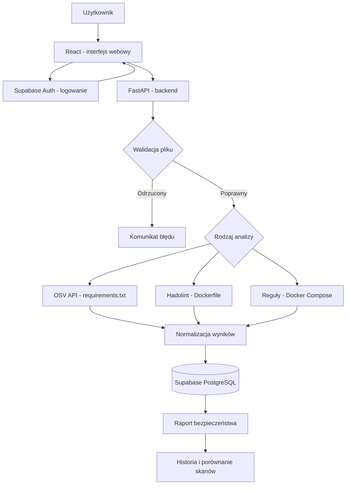
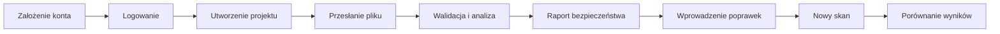

# SecureScope - diagram działania aplikacji

## Zasady bezpieczeństwa

- API weryfikuje token JWT i uprawnienia niezależnie od frontendu.
- Baza ma polityki RLS dla danych użytkowników.
- Tylko obsługiwane typy plików są dozwolone; brak uruchamiania przesłanych plików.
- Skanowanie odbywa się z limitami zasobów i czasowymi, w izolowanym środowisku.
- Wyniki są zapisywane bez ujawniania pełnych sekretów z przesłanych plików.
- Import z GitHuba to opcjonalne rozszerzenie, nieujęte w podstawowym diagramie.

## Prosty diagram procesu z perspektywy użytkownika

