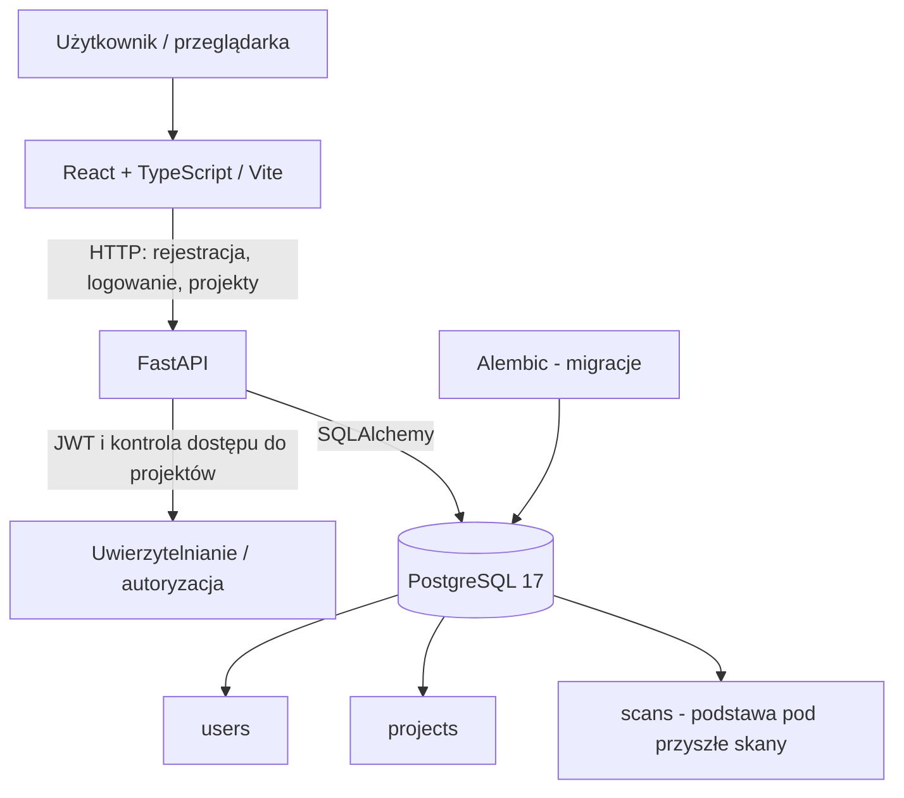
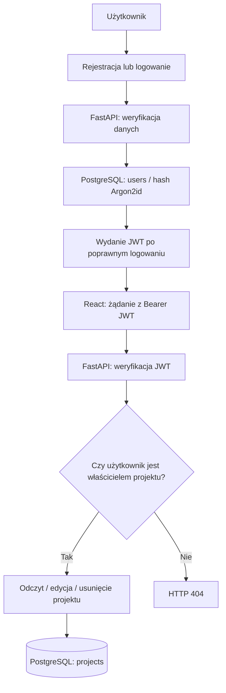
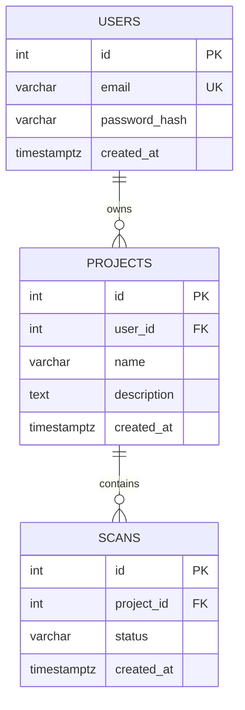
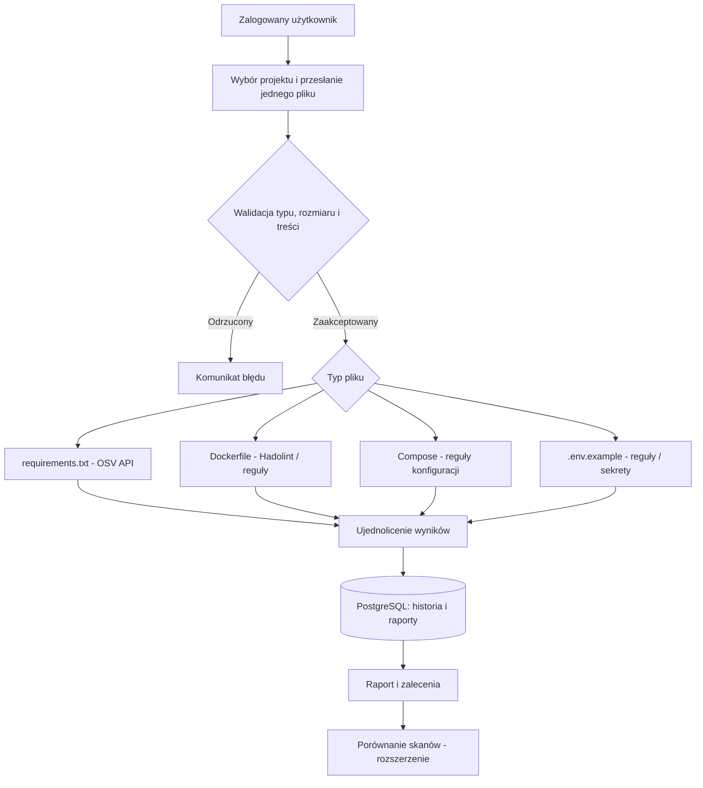

# Secure Scope - diagram architektury

## 1. Zaimplementowana architektura

Usługi `frontend`, `backend` i `db` działają w Docker Compose. Przeglądarka kontaktuje się z API na `localhost:8000`; backend łączy się z bazą przez wewnętrzny host `db:5432`.

## 2. Logowanie i obsługa projektów - etap 2

Dla tworzenia projektu backend przypisuje właściciela na podstawie zalogowanego użytkownika. Lista projektów jest filtrowana po `user_id`. Dla brakującego/niepoprawnego tokenu endpointy chronione zwracają HTTP 401.

## 3. Model relacji

Tabela `scans` istnieje, ale sam fakt jej istnienia nie oznacza, że interfejs skanowania i analizatory zostały zaimplementowane.

## 4. Docelowy proces analizy - plan

Poniższy diagram opisuje **funkcje na kolejne etapy**, a nie aktualnie działające endpointy.

## 5. Zabezpieczenia

**Zaimplementowane i przetestowane w etapie 2:**

- Hashe haseł w formacie Argon2id.
- JWT dla chronionych endpointów.
- Weryfikacja właściciela przy operacjach na projekcie (BOLA/IDOR).
- Walidacja nazw i opisów projektów.
- Parametryzowany dostęp do bazy przez SQLAlchemy.
- Sekrety konfiguracyjne przekazywane przez zmienne środowiskowe.

**Planowane / wymagające dalszej weryfikacji:**

- Bezpieczny upload, ograniczenia wielkości pliku, izolacja analizatorów i timeouty.
- Rate limiting, dodatkowe zabezpieczenia wdrożeniowe i audyt zdarzeń.
- Skanowanie kodu, zależności, sekretów i obrazów w CI zgodnie z planem projektu.
- TLS/HTTPS i nagłówki bezpieczeństwa przy wdrożeniu poza środowiskiem lokalnym.

## 6. Granice zaufania

1. **Przeglądarka -> API:** token i dane wejściowe są niezaufane, backend samodzielnie weryfikuje uwierzytelnianie, parametry i uprawnienia.
2. **API -> baza:** dostęp realizowany przez usługę backendu; kontrola własności projektu jest w logice API, a nie w Supabase RLS.
3. **Przyszły upload -> analizator:** zawartość pliku będzie traktowana jako niezaufane dane i nie może być wykonywana jako kod użytkownika.
